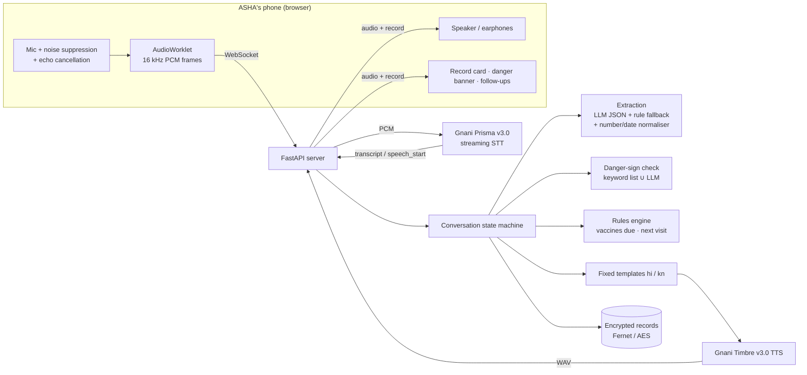

# ASHA Vaani — voice field register for ASHA workers

ASHA Vaani is a hands-free voice agent. An ASHA worker speaks her home-visit notes in Hindi or Kannada mixed with English. The agent:

- fills a structured visit record,
- reads it back so she can fix mistakes by voice,
- flags danger signs with a fixed "refer to PHC now" message,

all without any typing.

Built for the Gnani Voice Hackathon, PS1 Healthcare.

## Try it now

**Live demo:** https://asha-vaani-e4zd.onrender.com/

- Open it in **Chrome** (Android phone or laptop), tap **Start visit** and allow the microphone.
- Use **earphones**, so the agent doesn't hear its own voice.
- Pick **हिंदी + English** or **ಕನ್ನಡ + English** at the top, then follow the [demo script](#demo-script-2-minutes).
- The app runs on Render's free plan, which sleeps when idle. **The first load can take up to a minute.** After that it responds normally.
- No mic? Use the **typed box** at the bottom of the page. It runs the same flow.

**Code:** https://github.com/Santosh-S321/ASHA_Vaani

> **Prototype. Synthetic beneficiaries only.** The agent says it is an AI in its first turn. It gives no diagnosis, treatment or dosage advice.

## What it does

| Step | What happens |
|---|---|
| 1. Greeting | The agent says it is an AI, in her language, and asks for the beneficiary ID or name. |
| 2. Identify | "ID ek shunya char do" → finds ID 1042 in the synthetic register and confirms the name and type. |
| 3. Dictate | "vajan do point aath kilo, BCG laga" → weight 2.8 kg, BCG given today. |
| 4. Rules | Vaccines due and next visit date are computed from the national schedules, never guessed. |
| 5. Read-back | The agent reads the whole form aloud. The ID is read digit by digit and dates are spoken in full. |
| 6. Fix by voice | "nahi, weight 2.9 kilo" → only that field changes, and the agent confirms it. |
| 7. Save | "haan, save karo" → the record is encrypted and saved, and the follow-up list updates. |
| Any time | A danger sign ("baby ko tez bukhar hai") → the alert is spoken **first**, the record is flagged red and moves to the top of the follow-ups. |

## Gnani API Platform services used

| Service | Model | How it is used |
|---|---|---|
| Streaming speech-to-text | **Prisma v3.0** | WebSocket `wss://api.vachana.ai/stt/v3/stream`. Settings: `language_code` `hi-IN` or `kn-IN` (the live stream takes one locale), `format=codemix`, 800 ms end-of-speech pause. The browser sends 16 kHz 16-bit PCM in 1,024-byte frames. `speech_start` events stop agent playback, so she can interrupt (barge-in). |
| Text-to-speech | **Timbre v3.0** | REST `POST /api/v1/tts/inference`, stock voice `Shivani`, `language=auto`, WAV output. Every reply is a fixed template, so audio is cached on disk and repeated prompts cost no credits. |

No voice cloning. No telephony.

## Architecture



**Design rule:** the LLM only converts speech into JSON fields. Everything she hears comes from fixed templates. Danger signs, vaccine schedules and dates come from fixed rules. This is why the guardrails hold in a live demo.

## Setup (about 5 minutes)

Requires Python 3.10+ and Chrome.

```bash
git clone https://github.com/Santosh-S321/ASHA_Vaani.git
cd ASHA_Vaani
python -m venv .venv && source .venv/bin/activate      # Windows: .venv\Scripts\activate
pip install -r requirements.txt
cp .env.example .env
```

Edit `.env`:
- `GNANI_API_KEY`: your Gnani API Platform key.
- `DATA_ENCRYPTION_KEY`: generate one with
  `python -c "from cryptography.fernet import Fernet; print(Fernet.generate_key().decode())"`
- `LLM_API_KEY` and `LLM_MODEL` (optional): any OpenAI-compatible endpoint, such as Gemini or Groq. Without them, the rule-based extractor is used.

Run:

```bash
uvicorn app.main:app --reload --port 8000
```

Open http://localhost:8000, pick the language, tap **Start visit** and speak.

- **No key yet?** The typed box at the bottom of the page runs the same flow without voice.
- **On a phone:** browsers only allow the mic on HTTPS, so `http://` on your local network won't work. Use the [live demo](https://asha-vaani-e4zd.onrender.com/), deploy your own copy (below), or use an HTTPS tunnel to your laptop.
- **Earphones** stop the agent's own voice from being picked up by the mic.

## Deploy your own copy (Render)

The live demo runs on [Render](https://render.com) as a Python web service.

1. On Render: **New → Web Service** → connect this GitHub repo.
2. **Build command:** `pip install -r requirements.txt`
3. **Start command:** `uvicorn app.main:app --host 0.0.0.0 --port $PORT`
4. **Environment variables:**
   - `GNANI_API_KEY`
   - `DATA_ENCRYPTION_KEY`
   - `PYTHON_VERSION` = `3.11.9`
   - Optional: `LLM_API_KEY`, `LLM_MODEL`
   - Never upload `.env`.
5. Deploy, then open `https://<your-service>.onrender.com/api/status`. It should show `"gnani": true`.

Every push to `main` redeploys. On the free plan, stored records and cached audio are wiped on each redeploy or restart. That fits the "delete after judging" rule.

## Demo script (2 minutes)

Hindi + English (on the [live demo](https://asha-vaani-e4zd.onrender.com/) or locally):

1. "ID ek shunya char do" → Lakshmi's baby, newborn
2. "Baby ka vajan do point aath kilo hai, doodh theek pee raha hai"
3. Agent reads back. Say: "nahi, weight 2.9 kilo"
4. "haan, save karo"
5. "ID ek shunya char char" → Sunita's baby
6. "baby ko tez bukhar hai, vajan 3 kilo" → danger alert is spoken first, record flagged
7. "kaun si dawai dein?" → agent refuses to give advice and points her to the ANM or PHC
8. "haan save" → the case appears at the top of the follow-ups as REFER TO PHC

Kannada + English:

1. "ಐಡಿ ಒಂದು ಸೊನ್ನೆ ನಾಲ್ಕು ಎರಡು" (ID 1042)
2. "ತೂಕ ಎರಡು ಪಾಯಿಂಟ್ ಎಂಟು ಕಿಲೋ" (weight 2.8 kg)
3. "ಇಲ್ಲ, ತೂಕ ಎರಡು ಪಾಯಿಂಟ್ ಒಂಬತ್ತು ಕಿಲೋ" (correction)
4. "ಹೌದು, ಸೇವ್ ಮಾಡಿ" (save)
5. "ಐಡಿ ಒಂದು ಸೊನ್ನೆ ನಾಲ್ಕು ನಾಲ್ಕು", then "ಮಗುವಿಗೆ ಜ್ವರ ಇದೆ, ತೂಕ ಮೂರು ಕಿಲೋ" → danger alert first, record flagged
6. "ಯಾವ ಔಷಧಿ ಕೊಡಬೇಕು?" → refusal, points her to the ANM or PHC

Synthetic beneficiaries are in `app/data/beneficiaries.json` (IDs 1042, 1043, 1044, 2051, 2052, 3007).

## Danger-sign list and sources

The list is in `app/data/danger_signs.json`. The agent follows this list only and gives no diagnosis.

- **Newborn:** not able to feed; fits or convulsions; fast or difficult breathing; fever (hot to touch); cold to touch; weak cry or limp; yellow palms and soles; oozing or red umbilicus.
  Source: *Job Aid for Home Visits by ASHA (Newborn and Young Child)*, MoHFW 2018 — https://hbnc-hbyc.mohfw.gov.in/assets/document/English-Job%20Aid%20for%20ASHA%20on%20HBYC.pdf, and *Home Based Newborn Care Operational Guidelines (Revised 2014)*, MoHFW — https://hbnc-hbyc.mohfw.gov.in/documents/hbnc
- **Pregnancy and after delivery:** bleeding; fits; severe headache or blurred vision; high fever; severe abdominal pain; swelling of face or hands; reduced fetal movement; foul-smelling discharge.
  Source: *Mother and Child Protection (MCP) Card*, MoHFW and MoWCD.
- **Vaccines due:** *National Immunization Schedule*, NHM / MoHFW — https://nhm.gov.in/New_Updates_2018/NHM_Components/Immunization/report/National_%20Immunization_Schedule.pdf (JE is left out: endemic districts only).
- **Newborn visit days:** 3, 7, 14, 21, 28 and 42 (HBNC).

**How detection works:**
1. A keyword list in English, Hindi and Kannada, with negation handling ("bukhar nahi hai" is not flagged).
2. An LLM that may only answer with IDs from the list.

A sign is flagged if **either** check finds it, because a missed danger sign costs double.

## Responsible AI and compliance

| Rule | How it is met |
|---|---|
| AI disclosure | The first spoken line, in her language: "मैं एक AI सहायक हूँ, इंसान नहीं" / "ನಾನು AI ಸಹಾಯಕಿ, ಮನುಷ್ಯಳಲ್ಲ". |
| No health advice | All replies are fixed templates. Requests for medicine, dose or treatment get a fixed refusal pointing to the ANM or PHC. |
| Data | Synthetic beneficiaries only. Records are encrypted at rest (Fernet). Audio and transcripts are never written to disk. Delete everything with `python -m app.store purge`. |
| Secrets | API keys live in `.env`, which is listed in `.gitignore`. |
| Voices | Stock Timbre v3.0 voice only. No cloning. |

## Tests

```bash
pytest -q
```

The 20 offline tests need no API keys. They cover:
- number and date parsing in three languages,
- danger signs, including negation and Kannada,
- the vaccine schedule,
- full conversations: correction, danger alert, refusing advice, Kannada flow,
- encryption at rest,
- merging LLM output with rule output.

## Project structure

```
app/
  main.py          FastAPI server, WebSocket bridge, latency metrics
  gnani.py         Prisma v3.0 streaming STT + Timbre v3.0 TTS clients
  dialogue.py      conversation state machine
  extract.py       LLM JSON extraction + rule-based fallback
  normalize.py     spoken numbers, weights, relative dates (en / hi / kn)
  danger.py        danger-sign keyword check with negation
  schedule.py      vaccines due and next visit rules
  templates.py     every sentence the agent speaks (hi / kn)
  store.py         encrypted records, follow-up list, purge
  data/            synthetic beneficiaries, danger-sign list with sources
static/            browser app (mic capture, playback, record card)
tests/             offline tests
```

## Known limits and next steps

- Hindi and Kannada templates should be reviewed by native speakers.
- Prisma v3.0 returns final transcripts only, so extraction starts after each pause. Next step: move to Pipecat with the `pipecat-gnani` services and stream text-to-speech to cut time to first audio.
- Next-house brief and supervisor view for the ANM are planned.
- Build a measured test set: about 50 synthetic dictations recorded with street noise, scored for field accuracy, danger-sign recall and time to first audio.